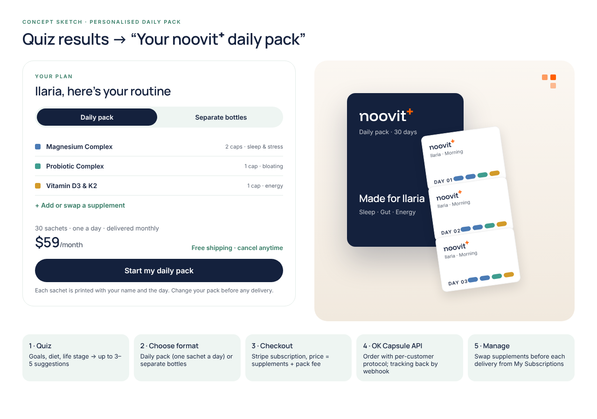

# Personalised Daily Pack: concept sketch

_27 Oct 2026. A possible second product line, fulfilled by **OK Capsule** (see `SUPPLIER_RESEARCH.md` §2.11). Nothing is built yet._

## The idea
The quiz already recommends up to three products. Instead of three separate bottles, the customer can choose **one sachet a day**. Each month they get a box of 30 sachets printed with their name and the day. Brands such as Care/of and Persona built their businesses on this format. It also gives the quiz a strong reason to subscribe.

Bottles stay the core range (Supliful). The pack is an **upgrade option** on the quiz results and on a `/daily-pack` page.

## Customer flow
1. **Quiz** → recommendations (as today), each with its daily dose.
2. **Choose format:** *Daily pack* or *Separate bottles* (a toggle on the results).
3. **Customise:** add, remove or swap supplements (max ~6 per sachet), within the same safety rules as the quiz (diet, pregnancy, sex).
4. **Checkout:** a Stripe subscription billed every 30 days. Price = sum of each supplement's monthly price + a pack fee. Shipping is free.
5. **Manage:** "My Subscriptions" lets them change the pack contents before the next delivery, then skip or cancel. This needs a small Noovit page, because the Stripe portal can't edit pack contents.

## Pricing sketch (to confirm with OK Capsule quotes)
| | Example |
|---|---|
| Magnesium (2 caps/day) + Probiotic (1) + D3&K2 (1) | 3 supplements |
| OK Capsule cost (unknown: per supplement + per order + shipping) | **quote needed** |
| Suggested retail | ~$59/month (vs. ~$90 for three bottles at one-time prices) |
| Target gross margin | 55–65% after fulfilment |

## How it plugs into the store
- **Catalog:** each product gets an `okcapsule_sku` and a daily dose, set in the admin product editor.
- **Checkout:** a dynamic Stripe price per pack (`price_data`), with the pack contents saved on the subscription's metadata.
- **Fulfilment:** a new "OK Capsule" supplier adapter.
  - After each paid invoice (first order and every renewal), call their REST API with the customer's protocol: SKUs, capsules per day, name, address.
  - Store their order id, and receive tracking by webhook, the same way as the bottle orders.
- **Admin:** pack orders appear in Orders and Fulfilment, marked "Daily pack".
- **Compliance:**
  - The pack label and our product page need a combined Supplement Facts panel for the whole pack, which OK Capsule's "FDA compliance engine" generates.
  - The same claims rules apply ("*" plus the FDA disclaimer).
  - Pregnancy and medication answers keep filtering suggestions.

## Before building
1. Quotes: per-supplement cost, per-order fee, shipping, and any monthly fee.
2. Which of our 15 products they can supply (their formulas under our names), and the exact formulas for our Supplement Facts.
3. API documentation and a sandbox: create order, update protocol, cancel, and the tracking webhook.
4. A branded sample pack: sachet print quality, box, insert.
5. Ingredient origin and COAs. Their third-party testing is **skip-lot**, so we would not say "every batch tested".

Rough build effort once the API docs are in hand: about 2–3 days for checkout, the adapter and the admin view, plus the pack-editing page.
